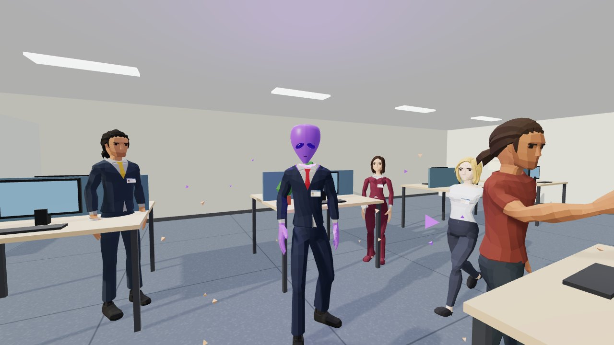

# OS FUNCIONÁRIOS

**Departamento de Recursos Não Humanos.** Cópias alienígenas estão substituindo
funcionários da Interplan S.A., 7º andar, e elas imitam quase tudo. Quase. Você
anda pelo escritório em primeira pessoa com um grampeador na mão, observa, pede o
crachá e grampeia só os impostores. Um humano abatido é uma falha. Três falhas e você está fora.

- **[Jogar](https://ai-games.luccabuilds.com/games/os-funcionarios/)** ou abra
  `index.html` desta pasta servido por HTTP (ver [Rodar](#rodar))
- **Parte de:** [ai-games](../../README.md)



## Como se joga

Cada dia começa com um **memorando do RH**: quantos impostores há no andar e uma
lista de sinais que a segurança recebeu. Nem todo sinal da lista é verdade: de um
a dois são boatos e não aparecem em ninguém naquele dia. Quem atira por boato
derruba um humano.

| Tecla | Ação |
| --- | --- |
| `W A S D` | andar (`Shift` corre) |
| mouse | olhar |
| botão direito ou `Z` | examinar de perto (zoom) |
| `E` | pedir o crachá e comparar com a ficha do RH |
| clique | disparar o grampeador (segure para rajada) |
| `R` | recarregar (12 grampos por pente) |
| `Tab` | abrir o memorando |
| `Esc` | pausa |

Cinco dias, das 9h às 18h (de quatro a cinco minutos e meio de jogo cada). O
andar enche e os sinais ficam mais finos:

| Dia | Pessoas | Impostores | Sinais por impostor | Que tipo de sinal |
| --- | --- | --- | --- | --- |
| 1 | 6 | 1 | 2 | visível de longe ou preste atenção |
| 2 | 7 | 1 | 1 | visível de longe ou preste atenção |
| 3 | 8 | 2 | 1 | preste atenção |
| 4 | 9 | 2 | 1 | preste atenção ou só de perto |
| 5 | 10 | 3 | 1 | qualquer um |

**O grampeador.** Um grampo derruba um humano. No alienígena, o primeiro grampo só
arranca o disfarce: a cabeça vira a roxa e ele corre para cima de você dando soco.
Ele aguenta mais três grampos. Cinco socos e você é nocauteado, e o dia acaba com
o impostor fugindo. Então atirar não termina a dúvida: começa a briga.

Alien eliminado vale 100. Humano abatido tira 150 e conta uma falha. Alien que
chega às 18h vivo foge e tira 50. Limpar o andar cedo dá bônus por minuto que
sobrou.

## Os 14 sinais

| Sinal | Nível | O que você vê |
| --- | --- | --- |
| Gira a cabeça além do limite | longe | vira a cabeça quase toda para trás, de vez em quando |
| Anda de ré | longe | as pernas andam para trás enquanto o corpo vai para a frente |
| Falha na imagem | longe | some e volta num piscar |
| Olhos brilhando verde | atenção | o olho acende verde por um instante |
| Pé virado para trás | atenção | um sapato aponta para o lado errado |
| Não tem sombra | atenção | a luz da janela passa por ele |
| Anda sem balançar os braços | atenção | braços colados no corpo ao andar |
| Respira vapor gelado | atenção | fumaça branca da boca |
| Caneca de cabeça para baixo | atenção | carrega o café de boca para baixo |
| Encara de volta | atenção | para tudo e encara quem fica olhando |
| Costura no pescoço | perto | linha de pontos logo acima da gola |
| Foto do crachá não confere | perto | o cabelo da foto é de outra cor |
| Nome errado no crachá | perto | uma letra trocada no nome |
| Pele molhada | perto | a pele brilha como se estivesse molhada |

## Por dentro

**As pessoas são do pacote, os funcionários são nossos.** Os personagens vêm dos
pacotes Ultimate Modular Men e Women, de [Quaternius](https://quaternius.com).
Cada modelo é dividido em cabeça, tronco, pernas e pés, e todos usam o mesmo
esqueleto. O jogo monta doze funcionários com oito modelos, trocando peças entre
eles: o Jorge, da Manutenção, é a cabeça de bigode do operário (com o capacete
escondido) no corpo de terno do executivo. Depois recolore por nome de material
(`Suit`, `Tie`, `Hair`, `Skin`) e pendura crachá e caneca nos ossos.

**Os sinais são escritos por cima da animação pronta.** O pacote traz andar,
parado, interagir e cair. Os sinais de corpo giram ossos depois que o mixer
anima: a cabeça vai a 170 graus, o pé gira meia volta, os braços voltam à pose
de repouso enquanto as pernas andam. Um bug ensinou a regra: quando a animação
não tem trilha para um osso, o ajuste do quadro anterior fica e o seguinte soma
por cima. A cabeça girava sem parar e o rosto nunca voltava. Agora cada quadro
restaura a pose desses ossos antes de animar.

**Arquivo menor sem Blender.** Cada `.glb` do pacote carrega as mesmas 24
animações. `preparar_modelos.py` (fora desta pasta, no repo de trabalho) reempacota
o binário do glTF à mão: malha e materiais em `modelos/pessoas/`, o esqueleto e as
dez animações usadas uma vez só em `animacoes.glb` (homens) e `animacoes_mulher.glb`
(mulheres). De 9,5 MB para 6,4 MB. São dois arquivos porque os modelos femininos do
pacote têm outra orientação de repouso no tronco, nos braços e nas pernas: a animação
do esqueleto masculino tocada nelas fazia as funcionárias andarem com o braço para trás.

**A arma é nossa.** O grampeador é o nível 1 ("Grampeador Improvisado") do kit
O GRAMPEADOR, que fizemos em Blender por código para outro teste: peças modulares,
texturas assadas. `preparar_arma.py` tira só as peças do nível 1, descarta as
tangentes e reduz as texturas para 512 px (5,7 MB do kit inteiro para 590 KB). Ela é
desenhada numa segunda cena por cima do escritório, para nunca atravessar parede
nem mesa, com balanço ao andar, coice e recarga. O grampo é um U de arame que voa
da ponta e fica cravado no osso mais perto de onde acertou, ou solta faísca na
parede.

**O alienígena é procedural.** A cabeça roxa, com olho amendoado e brilho, é
geometria do código, e aparece no lugar da cabeça humana no meio da revelação. O
inocente cai com a animação de morte do pacote. O escritório, o crachá (desenhado
num canvas, com a foto e o nome que podem estar errados), as partículas e o som
também são do código: não há textura, fonte ou áudio em arquivo.

## Rodar

```bash
cd games/os-funcionarios
python3 -m http.server 8000      # e abra http://localhost:8000
```

Precisa de HTTP porque o jogo é feito de módulos ES e carrega `.glb`. Abrir o
`index.html` direto do disco não funciona.

As provas abrem o jogo num Chrome sem cabeça e jogam por uma API de teste
(`window.__jogo`):

```bash
node provas.mjs                     # 21 provas
cd ferramentas && node sinais.mjs   # uma foto de cada sinal, em fotos/sinais/
```

Em Linux com GPU Intel, o Chrome sem cabeça precisa de WebGL por ANGLE
(`ferramentas/cdp.mjs` já pede `gl-egl`). Se o Chrome não estiver no caminho
padrão, use `CHROME=/caminho/do/chrome node provas.mjs`.

## Como foi feito

O pedido era um jogo de dedução com funcionários de escritório e sinais de
alienígena, desenvolvido de madrugada, sem ninguém validar, para ser jogado de
manhã.

**A maior parte do custo foi chegar ao personagem certo, não o jogo.** A sessão
começou com um kit de funcionários feito do zero em Blender: oito rodadas de
redesenho, 17 sinais, teste cego, vídeo. O dono do repo achou feio ("ainda tá feio
KKKKK") e mandou uma referência no estilo brinquedo 3D. Veio um protótipo em
superfície contínua (metaballs), que melhorou, mas ficou simples. O que resolveu
foi testar um pacote pronto, o Quaternius, e mostrar com uma imagem que dava para
trocar roupa e marcar o alienígena nele. Só então começou o jogo.

**O jogo em si custou cerca de um quinto do total** e saiu em uma noite: dados,
pessoas, escritório, laço do jogo, som, provas, nessa ordem. O que deu trabalho:

- **Nome de osso.** O three.js tira o ponto do nome (`Wrist.R` vira `WristR`). O
  crachá e a caneca não achavam a mão e o jogo travava no carregamento.
- **CSS que não carregava.** O servidor de teste não conhecia `.css`. Quando passou
  a conhecer, todas as telas apareceram juntas ao mesmo tempo: `display: flex`
  vence o atributo `hidden`.
- **Cabeça que não voltava.** É o bug dos ossos descrito acima. A foto do sinal
  mostrava a nuca nos dois quadros, e só medindo a posição do olho a cada quadro
  ficou claro que o giro se acumulava.
- **O alienígena morria direto.** Na primeira versão um clique eliminava
  qualquer um, e o dono do repo reclamou com razão. Agora o primeiro grampo só
  revela, e o alien luta. Veio junto com a arma visível, que também faltava.
- **O jogador começava olhando para a parede.** Foi a prova do teclado de verdade
  que pegou: segurar `W` andava para trás. A direção inicial estava invertida.

Cada etapa visual passou por foto e revisão: as 14 provas de sinal foram refeitas
três vezes até todos aparecerem.

**O que ficou de fora.** O olho do pacote é pintado e não tem pálpebra, então os
sinais de piscar do kit antigo não entraram. Dedo a mais e sombra atrasada também
ficaram de fora. De perto, o rosto do pacote é facetado. No celular não roda: o
controle é teclado e mouse.

## Custo

Medido em 2026-10-17 15:47 no banco de sessões do Hermes (`session_model_usage`),
somando a sessão do projeto e os dois subagentes dela.

| | Chamadas | Entrada | Saída | Cache lido | Cache gravado | US$ (tabela) |
| --- | --- | --- | --- | --- | --- | --- |
| Opus 5.5, caminho inteiro | 421 | 7.711 | 786.495 | 69.067.829 | 4.347.598 | US$ 64,36 |
| DeepSeek Flash, caminho inteiro | 201 | 476.015 | 405.387 | 29.645.312 | 0 | US$ 0,40 |
| **Total do caminho** | | | | | | **US$ 64,76** |
| Opus 5.5, só o jogo | 183 | 3.466 | 421.316 | 32.351.858 | 1.294.008 | US$ 25,27 |
| DeepSeek Flash, só o jogo | 2 | 29.093 | 31.340 | 27.904 | 0 | US$ 0,02 |
| **Total só do jogo** | | | | | | **US$ 25,29** |

- **"Caminho inteiro"** inclui o kit em Blender que foi descartado, o protótipo de
  estilo e o teste do pacote. **"Só o jogo"** é a diferença do contador entre o
  retrato tirado às 00:25 de 17/10, quando o jogo começou, e a medição acima.
- **O dólar é estimado.** O Opus rodou em plano de assinatura: o valor é a tabela de
  preço do modelo aplicada aos tokens, não uma fatura.
- **O cache lido é o maior número e não é o custo.** Cada chamada reenvia o contexto
  acumulado, e o cache evita pagá-lo a preço cheio.
- **Máquina:** tudo rodou num servidor doméstico (i7-7500U, 16 GB, GPU Intel HD 620),
  sem GPU na nuvem. Blender, Chrome sem cabeça e as provas rodaram ali, com prioridade
  baixa. Não houve outro gasto além dos tokens.
- **Tamanho publicado:** 8.0 MB, dos quais 6,2 MB são os modelos e 0,7 MB o three.js.
